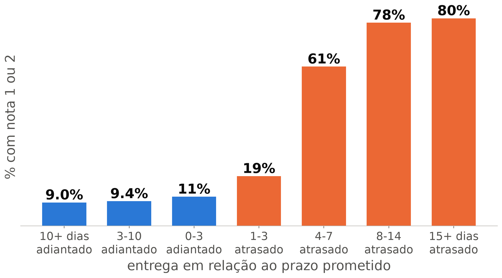
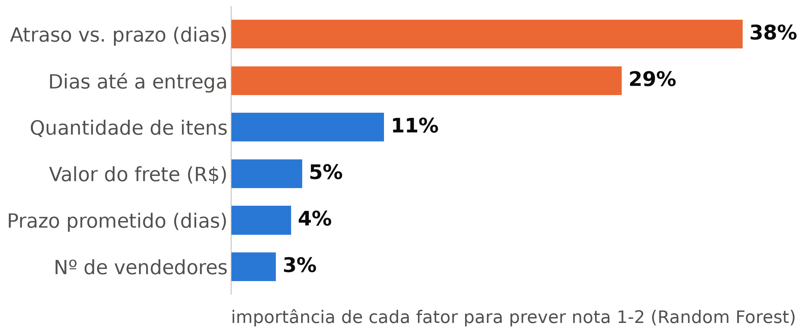
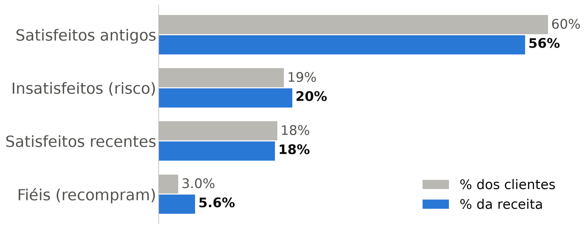
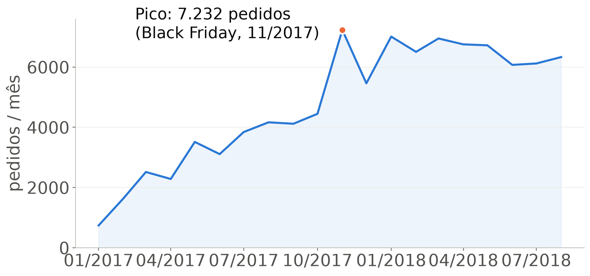
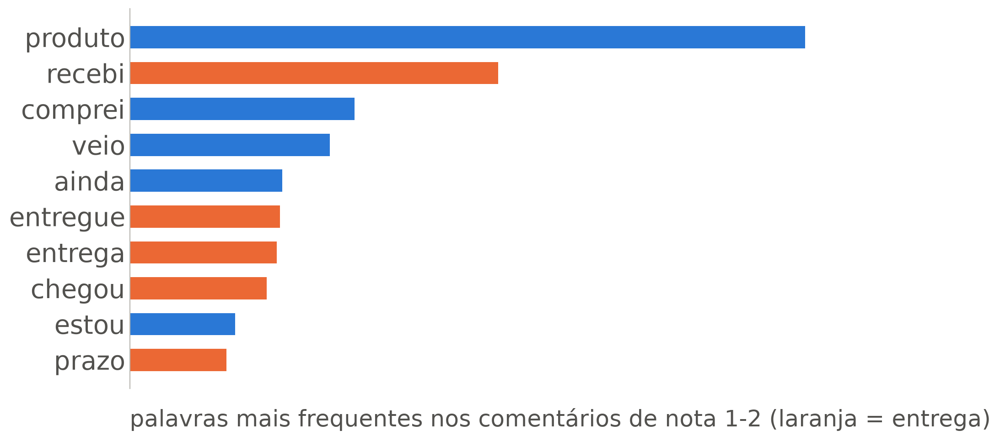

# Por que o cliente da Olist fica insatisfeito?

Projeto prático do **Seminário Avaliativo de Big Data** (Sistemas de Informação, 6º período, Prof. MSc. Cloves Rocha).

**Pergunta de negócio:** o que leva um cliente de e-commerce a avaliar mal (nota 1 ou 2), e dá para prever isso antes da avaliação?

**Dados:** [Brazilian E-Commerce Public Dataset by Olist](https://github.com/olist/work-at-olist-data). São 9 tabelas, 1,55 milhão de linhas e 119 MB, com cerca de 100 mil pedidos reais de 2016 a 2018.

## Como rodar

```powershell
python -m venv .venv
.\.venv\Scripts\python -m pip install -r requirements.txt
.\.venv\Scripts\python run_pipeline.py
```

O pipeline baixa os dados sozinho e leva cerca de 2 minutos.

## Estrutura

| Arquivo | Etapa | O que faz |
|---------|-------|-----------|
| `src/coleta.py` | **Extract** | Baixa os 9 CSVs e mede os 3 V's → `reports/tres_vs.json` |
| `src/tratamento.py` | **Transform + Load** | Limpa, junta 7 tabelas, cria variáveis (atraso, frete/valor…) e grava Parquet → `reports/governanca.json` |
| `src/mineracao.py` | **Mineração** | Random Forest, K-Means (RFM) e mineração de texto → `reports/resultados.json` e `reports/figuras/*.png` |
| `run_pipeline.py` | Orquestração | Roda as 3 etapas em sequência |

## Principais resultados

- **No prazo, 9% de insatisfeitos. Com atraso, 54%.** Acima de 8 dias de atraso, cerca de 80% dão nota 1 ou 2.
- **Random Forest:** AUC de 0,76 (o acaso daria 0,50) e 54% dos insatisfeitos detectados. Tempo de entrega responde por 67% da importância do modelo.
- **K-Means (k = 4, silhueta 0,37):** 19% dos clientes formam um grupo de risco (nota média 1,9). Só 3% recompram, mas gastam o dobro.
- **Texto:** 64% dos comentários negativos falam de entrega ou recebimento.
- **Curiosidade:** pedidos com 2 ou mais vendedores têm 47% de insatisfeitos, mas quase nunca atrasam (1,3%). 66% das queixas são de **entrega parcial**: cada vendedor envia um pacote separado.

## Gráficos

**Insatisfação por atraso na entrega** (% de pedidos com nota 1 ou 2)



**Importância de cada fator no Random Forest**



**Perfis de cliente descobertos pelo K-Means**



**Velocidade: pedidos entregues por mês**



**Palavras mais frequentes nos comentários de clientes insatisfeitos** (laranja = entrega)



## Tecnologias

Python 3 · pandas · scikit-learn · matplotlib · PyArrow (Parquet)

## Limitações

Os dados são estáticos (2016–2018) e não incluem custo logístico. A precisão do modelo é de 39% (ele gera falsos alarmes). Só 41% das avaliações têm comentário escrito, o que pode causar viés. Esta amostra cabe em pandas; em produção, o mesmo pipeline rodaria em Spark.
